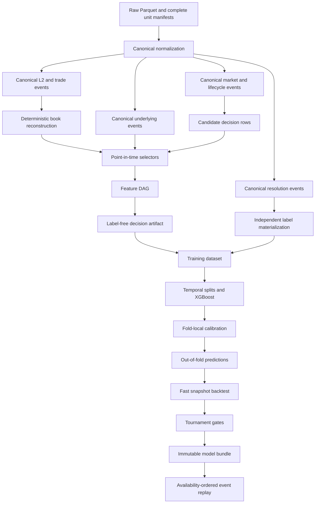

# BTC 5-Minute Research Framework Plan

Status: design and lake-readiness audit, 2026-07-27. This document defines the recommended implementation sequence; it does not claim that assembler, training, or backtesting commands exist yet.

## Goal and optimization target

Build a reproducible BTC 5-minute pipeline that can:

1. Assemble one point-in-time decision row for every candidate market window.
2. Train and calibrate XGBoost outcome-probability models on temporal splits.
3. Convert probabilities into UP/DOWN trade intents using executable prices and explicit costs.
4. Iterate quickly in a snapshot backtester.
5. Replay only finalists against availability-ordered events and realistic execution assumptions.
6. Promote the same feature and strategy semantics to paper and live systems.

The primary selection objective should be **conservative net expectancy at useful coverage**, subject to causality, calibration, drawdown, and runtime-eligibility gates. Win rate is an important reported metric, but it is not sufficient by itself: a strategy can achieve a high win rate by rarely trading or by accepting occasional losses larger than its frequent gains. Every tournament should report a coverage–win-rate–expectancy frontier rather than one isolated accuracy number.

## Current evidence

### Lake inventory

The external lake at `/Volumes/chofer-data/data` contains approximately 312 GB of raw data, 7,764 manifests, and 727,546 Parquet files. Committed-manifest coverage relevant to BTC 5-minute research is:

| Dataset | Complete coverage | Important caveat |
|---|---|---|
| PMData `poly_l2`, `btc-5m` | 149 contiguous days, 2026-02-26 through 2026-07-24 | 42,797 market files; not every day has 288 members |
| PMData `poly_trade`, `btc-5m` | Same 149 days | 42,705 files; zero-row members can be intentionally absent |
| PMData `onchain_fills`, `btc-5m` | Same 149 days | 42,690 files; no observed/confirmation time or slug column in rows |
| Binance BTCUSDT spot klines | 148 complete days | 2026-07-21 unavailable in the lake |
| Binance BTCUSDT aggregate trades | 148 complete days | 2026-07-21 unavailable in the lake |
| Binance BTCUSDT futures metrics | 148 complete days through 2026-07-23 | 2026-07-24 unavailable; boundary convention changes in the history |
| Binance BTCUSDT premium-index klines | 147 complete days through 2026-07-23 | 2026-06-29 and 2026-07-24 unavailable |
| Gamma market metadata, series 10684 | One snapshot ingested 2026-07-25 | 43,019 markets; mutable lifecycle and terminal label fields coexist |

There are 42,253 slugs common to all three PMData datasets and the metadata snapshot. Requiring a resolved Gamma label and all four Binance datasets on the calendar date leaves approximately 41,395 raw candidates, but this is not yet an assembly-ready row count: candidate-level quality, point-in-time availability, reconstruction validity, and eligibility still need to be applied.

PMData configuration says BTC 5-minute recording starts at `2026-02-13T17:00:00Z`, while the lake has no manifests for February 13–25. That range must be indexed or explicitly recorded as unavailable before a spec requests it.

### Label evidence

The series-10684 snapshot has:

- 43,019 structurally valid two-outcome markets with `Up` and `Down`.
- 42,732 terminal outcomes: 21,371 Up and 21,361 Down.
- Chainlink BTC/USD as the resolution source for every row.
- No persisted Chainlink opening/closing stream values with which to independently reproduce the official rule.
- No historical Gamma publication time per resolution.

The snapshot was ingested on July 25, so its `closed`, `active`, terminal prices, and winner cannot be backdated into February–July decisions. Static identifiers and window fields may be used as a retrospective candidate sampling frame only when physically separated from strategy-visible lifecycle and label fields.

Recent PMData L2 files contain `market_resolved` events with provider receive times. On five checked dates, 1,431 such events agreed with Gamma. On 2026-03-28, resolution became observable about 104–187 seconds after window end. This can supply causal resolution-availability evidence where present, but coverage is not universal.

Recommended label construction:

1. Normalize Gamma's terminal outcome as the official label content only after validating resolution status, two outcomes, rule source, and snapshot lineage.
2. Normalize PMData `market_resolved` as a causal resolution observation with `available_at = local_timestamp` under a versioned skew policy.
3. Join the two as `official_outcome` plus `resolution_available_at`, confidence, and disagreement reason.
4. For walk-forward fitting, use a prior example only when its resolution was available by that fold's `model_fit_at`.
5. Do not reconstruct the oracle rule from incomplete historical streams; retain
   the official Gamma outcome and PMData resolution corroboration as the label path.

### Representative vertical-slice window

Use `btc-updown-5m-1784332800`, covering 2026-07-18 00:00–00:05 UTC, as the first implementation fixture:

- L2: 135,003 rows, including one `market_resolved=no` received at `00:06:32.973811`.
- Trades: 5,317 rows with both `yes` and `no` outcomes.
- On-chain fills: 17,141 rows.
- Gamma: `Down`, resolution status `resolved`, Chainlink BTC/USD source.
- All 288 market files exist for every PMData dataset that day.
- All four Binance units needed for the date exist.

The fixture should pin exact raw manifest IDs and checksums. Do not check the full raw files into Git; create a small legally permissible, behavior-complete extract after reconstruction semantics are defined.

### Measured PMData availability

For all BTC 5-minute rows on 2026-07-18:

| Stream | Median `local_timestamp - timestamp` | p95 | p99 | Maximum |
|---|---:|---:|---:|---:|
| L2 | 4.768 ms | 11.830 ms | 44.381 ms | 31.056 s |
| Trade | 8.508 ms | 42.292 ms | 89.859 ms | 3.482 s |

Latency varies by date. Some sampled periods have much larger tails, and four markets on 2026-07-23 contain small negative measured delays. `local_timestamp` is useful evidence, not a guarantee of perfect clocks or complete end-to-end live availability. A production policy should conservatively clamp impossible negative values, preserve source row order, account for processing/inference delay separately, and version every rule.

PMData event and local timestamps are timezone-naive Arrow timestamps that appear to represent UTC. Canonical normalization must attach UTC explicitly; host-local conversion can shift a slug by hours.

## Why the current draft config must not drive training

`configs/assembler/` is useful as a feature brainstorm, but it is not an executable or safe contract yet:

1. `pyproject.toml` advertises `assembler.cli:main`, but `src/assembler/` does not exist.
2. The raw path patterns omit `date=` and do not define whether paths are relative to the lake or raw root. Input files should be selected from complete manifests instead of duplicated globs.
3. The L2 projection includes `winning_outcome`; arbitrary feature functions are described as receiving raw streams. That makes label leakage possible by construction.
4. Historical-outcome features read a label stream using only `window_end < decision_at`; the actual resolution must have become available before the decision.
5. A one-second fallback when `local_timestamp` is absent violates the accepted fail-closed availability policy.
6. The July 25 Gamma snapshot cannot represent historical lifecycle state at earlier decisions.
7. Raw L2 consists of `book`, `price_change`, and `market_resolved` events. The latest row is not necessarily a complete book; deterministic reconstruction is required.
8. `offset_seconds = 270` does not name its anchor and describes an intra-window decision, while the stated immediate goal is premarket entry.
9. The 49–51 rule uses a midpoint without resolving whether eligibility should use midpoint, best ask, or size-weighted executable price.
10. All features are asserted to be production-eligible despite having no implementation, live binding, compute budget, parity evidence, or null contract.
11. Binance daily archives are not proof that the same values were available intraday. Current-window Binance features need a documented historical-to-live stream binding and latency policy.
12. The repository checklist references a contract package, point-in-time kernel, feature DAG, and tests that are absent from the current checkout. Those changes must be recovered or their checklist evidence corrected before building on them.

Do not repair these issues by adding permissive defaults. Unknown availability, lifecycle state, sequence validity, or label status should produce a typed exclusion reason.

## Target architecture



### Minimal package boundaries

Create packages only as their first vertical behavior is implemented:

- `contract`: identifiers, exact numeric types, UTC timestamp semantics, event envelope, availability evidence, lifecycle, resolution, and Arrow schemas.
- `assembler`: validated dataset specs, manifest snapshots, normalization orchestration, book state queries, point-in-time selectors, feature DAG, evidence, and dataset artifacts.
- `training`: split manifests, baselines, XGBoost fitting, calibration, prediction artifacts, metrics, and model bundles.
- `backtest`: shared strategy intents, fast snapshot simulation, tournament reports, and later event replay.

Do not create empty service layers or duplicate feature semantics between training and live code.

## Canonical contracts required before broad assembly

### Event envelope

Every canonical event should include:

- Stable event and source-record identity.
- Source, dataset, canonical schema ID/version, and normalizer version.
- Raw manifest/file checksum and source row identity.
- `event_time`.
- `source_publish_time`, when present.
- `observed_at`, when measured.
- `available_at`, produced by a named and versioned policy.
- `ingested_at`.
- Sequence, correction, and tombstone metadata where available.

The point-in-time invariant is always:

```text
maximum contributing available_at <= decision_at
```

`event_time <= decision_at` is necessary but insufficient.

### Market and decision identity

Normalize `Asset`, `Interval`, `SeriesId`, `MarketId`, `ConditionId`, `TokenId`, `Outcome`, and `WindowId`. Derive BTC 5-minute window bounds from a validated slug epoch and `end_date`, not Gamma's creation-like `start_date` field.

Each candidate row is identified by:

```text
WindowId × DecisionScheduleId
```

A schedule must name its anchor and signed offset, for example:

```toml
anchor = "window_start"
offset = "-30s"
```

Premarket offsets relative to `window_start` and intra-window offsets such as `window_end - 30s` are different model families. Keep them in separate experiments even if both are eventually useful.

### Exact numeric representation

Raw prices and sizes are binary floats. Normalize prices and monetary values to exact decimal or integer tick representations before equality-sensitive logic, eligibility, costs, and accounting. Convert to floating point only at model-input or metric boundaries where required.

### L2 reconstruction

Before computing book features:

1. Establish whether each `book` event is a full snapshot and each `price_change` event's exact mutation semantics.
2. Preserve archive/source row ordinal; many rows share the same event and local timestamps.
3. Define deterministic ordering using provider receive order and row ordinal rather than silently sorting only by event time.
4. Define reset, duplicate, out-of-order, tick-size, level deletion, crossed-book, and invalid-state behavior.
5. Never bridge an unprovable gap silently.
6. Record `last_valid_update_at`, freshness, and invalid/gap state at every query.
7. Re-establish the exact UP/DOWN side mapping and executable-price relationship before simulating both sides.

A row with an invalid book is ineligible; an invalidity indicator alone must not turn it into a tradable example.

## Dataset specification and artifacts

### Dataset spec

A versioned spec should define:

- Universe and candidate source.
- UTC half-open time range.
- Decision schedules with explicit anchors.
- Feature names and exact versions.
- Per-selector availability-policy IDs and versions.
- Required lookback/warm-up range.
- Label policy and accepted confidence states.
- Required quote side, depth/notional, staleness, and lifecycle rules.
- Coverage and schema requirements.
- Exclusion policy.
- Split-policy reference.
- Named deterministic seeds.

A human name such as `btc-5m-premarket-v1` is not the immutable dataset ID. Compute the ID from canonicalized behavior, exact input manifest/file checksums, schemas, code/dirty-tree version, feature implementation hashes, policies, and seeds.

### Physical label separation

Feature functions must receive typed, allow-listed canonical projections that cannot contain current or future outcome fields. Produce and hash the label-free decision artifact before label attachment. Historical-resolution features, if later allowed, consume a separate causal past-resolution selector and prove `resolution_available_at <= decision_at`.

### Recommended dataset tables

Keep physically or logically separate tables with stable row IDs:

- `candidates`: every expected window and decision schedule, including missing-data windows.
- `eligibility`: state/quote/feature eligibility and ordered reason codes.
- `quotes`: side-specific bid/ask and requested-size executable prices at decision and simulated execution times.
- `features`: model values in a stable, versioned column order.
- `feature_evidence`: null reason, latest input event time, maximum input availability time, age, selector policy, and lineage reference per feature.
- `labels`: official/reconstructed outcomes, confidence, availability, and disagreement reasons.
- `manifest`: source snapshot, spec, versions, hashes, counts, and deterministic seeds.

This preserves the full funnel:

```text
all candidate windows
→ state-valid rows
→ feature-eligible rows
→ quote-eligible rows
→ strategy intents
→ submitted simulated orders
→ filled orders
```

Never report a single unlabeled “coverage” denominator.

### Storage zones

Once the zone decision is formalized, keep large artifacts on the external lake:

```text
data/canonical/...
data/derived/datasets/<dataset_id>/...
data/artifacts/experiments/<experiment_id>/...
data/artifacts/models/<bundle_id>/...
data/artifacts/backtests/<backtest_id>/...
```

Use staged writes and an atomic manifest-last commit, mirroring raw-zone durability. Artifacts are immutable; human names and champion pointers may refer to hashes but must not overwrite history.

## Feature roadmap

### Tier 0: mandatory baselines

Train/evaluate these before complex features:

- Constant 0.5.
- Expanding historical UP rate using only resolutions available by fit time.
- Market-implied midpoint baseline for prediction diagnostics.
- Executable-price no-edge baseline for trading diagnostics.
- XGBoost that learns a residual correction to market-implied log-odds.

The market price is already a strong probability forecast. A model that cannot add stable information beyond it should not trade.

### Tier 1: Polymarket microstructure

After deterministic reconstruction:

- UP/DOWN best bid and ask.
- Spread and size-weighted executable price at configured notionals.
- Depth at several levels/notionals.
- Book imbalance and microprice.
- Complement inconsistency between outcome books, if the side contract supports it.
- Book-update intensity and trend.
- Recent signed trade flow, volume imbalance, count, and size distribution.
- Quote, trade, and feature freshness.
- Missingness, delay, source-health, and reconstruction-state features.
- Time to window start/end, time of day, and day of week.

Define signed trade pressure from both `outcome` and `side`; “yes versus no” volume alone does not fully define aggressive buying/selling.

### Tier 2: live-equivalent Binance features

Potentially valuable features include:

- Returns over 1s/5s/15s/30s/60s/5m lookbacks.
- Signed aggregate-trade flow and trade intensity.
- Realized volatility, range, jumps, and trend/mean reversion.
- Spot/premium basis and premium changes.
- Open-interest, long/short, and taker-volume-ratio changes.

Do not use a completed kline before its close. Do not infer one timestamp unit across datasets. Futures metric start/end semantics and the historical boundary shift must be verified.

The daily archive itself becomes available after the market decision. Current-window features become production-eligible only after documenting that archived records are semantically equivalent to a live stream, defining the live selector and conservative measured delay, and validating historical/live parity. Until then:

- Prior completed archives can support genuinely prior-day features after publication.
- Current-window archive-derived features are explicitly research-only and cannot be promoted.

### Tier 3: resolution-aligned oracle features

Official-reference distance features are deferred. They require a complete,
causally timed historical oracle source; the partial PMData stream archive is
not part of the initial training pipeline. Binance distance remains a
predictive proxy, not the official resolution distance, and must be named
accordingly.

### Tier 4: cross-asset context

Only after the BTC path is stable, add independently selected ETH/SOL/XRP returns, volatility, flow shocks, and market microstructure. Cross-asset missingness must not silently eliminate BTC rows.

## Temporal training and leakage controls

### Split rules

Use chronological or expanding walk-forward splits only. All rows for one market stay in one fold. For each simulated model fit, a training example is allowed only when:

```text
decision_at < model_fit_at
window_end < model_fit_at
resolution_available_at <= model_fit_at
```

Also:

- Purge examples whose outcome intervals overlap the next block.
- Fit calibration on a block separate from early stopping and evaluation.
- Fit any learned preprocessing only on that fold's permitted history.
- Never select features, thresholds, or hyperparameters on the final holdout.
- Use an optional extra embargo as a serial-dependence stress test, not as a replacement for point-in-time correctness.

Because the existing draft already names July as a test period, it may not be a pristine holdout. Use walk-forward development on existing history, then lock the pipeline and reserve newly arriving fully resolved markets as the strongest forward test.

A reasonable configurable fold template for the available history is:

- 42 or more days expanding core training.
- 7 days early stopping.
- 7 days calibration.
- 7 days evaluation.
- Advance by 7 days.

These durations are experiment parameters, not domain rules. Materialized row counts and regime coverage should determine whether longer blocks are needed.

### XGBoost protocol

Start with a small deterministic CPU baseline:

- `objective = binary:logistic`.
- Log loss for early stopping, with Brier/calibration reported separately.
- Pinned XGBoost/runtime versions and hardware metadata.
- Named seeds and deterministic feature ordering.
- Shallow/moderate trees, learning rate, child weight, row/column sampling, and regularization in a constrained temporal search.
- No class weights unless measured imbalance and the desired probability semantics justify them.

Store raw out-of-fold predictions before threshold selection. Hyperparameter trials compare exactly the same fold rows and baselines.

### Calibration

Trading compares predicted probabilities with executable prices, so calibration is mandatory. Tournament:

1. Raw XGBoost probability.
2. Fold-local logistic/Platt calibration.
3. Isotonic calibration only when calibration blocks have enough independent windows.

Report log loss, Brier score, calibration intercept/slope, adaptive-bin expected calibration error, and reliability curves. Segment by probability/price bucket, time, volatility, liquidity, spread, side, and feature freshness.

## Shared strategy and fast backtest

The model outputs `p_up`; strategy code—not the model—decides whether to trade. For each side:

```text
UP edge   = calibrated_p_up       - executable_up_price   - all_costs - safety_margin
DOWN edge = (1 - calibrated_p_up) - executable_down_price - all_costs - safety_margin
```

Use a typed strategy input and output:

- Input: model bundle ID, feature row ID, decision quote, risk context, lifecycle state, and decision time.
- Output: abstain or a side, order type, exact size, limit/crossing price, expiry, and reason codes.

The first strategy should be deliberately narrow:

- One BTC 5-minute premarket decision.
- Fixed small configured notional.
- Taker/crossing entry only.
- No add, exit, or intra-window management.
- Explicit hard exposure limits.

The fast backtest reads two isolated views:

1. A model-visible decision snapshot at `D`.
2. A simulator-only execution snapshot at `D + modeled latency`.

The simulator may use later data to estimate execution, but the model and threshold features cannot access it. Initial fills should consume visible depth conservatively, apply exact fees and a versioned adverse-selection/slippage allowance, and reject or partially fill when depth is insufficient. It must never claim maker queue realism.

Every result identifies `execution_mode = fast` and the fill, cost, quote-depth, and latency policy versions.

## Tournament gates and metrics

### Hard data gates

Reject a candidate for:

- Any feature evidence after decision time.
- Duplicate/cross-fold markets.
- Unresolved required coverage or schema compatibility.
- Unstable dataset/artifact hashes.
- Current-label fields reachable from the feature DAG.
- Invalid or unproven book state.
- Missing live path or compute budget for a production feature.

### Predictive metrics

- Log loss and Brier score.
- Calibration slope/intercept and expected calibration error.
- ROC-AUC only as secondary discrimination context.
- Paired improvement over 0.5, historical-prior, and market-implied baselines.

### Trading metrics

Report separately per candidate, eligible row, intent, and assumed fill:

- Gross and net expectancy.
- Total and average PnL.
- Win rate with confidence intervals.
- Coverage/abstention and the full threshold frontier.
- Profit factor, drawdown, and tail loss.
- Turnover and capital usage.
- UP/DOWN mix and concentration by day/regime.
- Fill rate, partial fills, price impact, and slippage assumptions.

Prefer block-bootstrap intervals by day or another serially meaningful block rather than independent-row confidence intervals.

### Stress tests

A candidate should remain acceptable under agreed scenarios for:

- Higher fees, spread, and slippage.
- Source and execution latency tails.
- Reduced fill rates and depth.
- Stale or missing inputs.
- Volatility/liquidity regimes.
- Time-of-day and calendar segments.
- Removal of the most profitable days or markets.

Selection should first pass causality, calibration, minimum-sample, runtime, and stress gates; then maximize a conservative lower confidence bound on net expectancy. Use win rate and coverage to choose among economically similar survivors.

## Event replay boundary

Fast backtesting is for broad feature, model, calibration, and threshold iteration. Event replay is for finalists and difficult windows. Replay must:

- Process information in modeled `available_at` order.
- Use the same feature and strategy contract.
- Reconstruct books continuously and retain invalid/gap state.
- Simulate observation, compute, submission, acknowledgement, and fill delays.
- Handle visible depth, partial fills, rejects, tick/minimum constraints, and later maker queue behavior.
- Track exact balances, positions, fees, market close, resolution, and redemption.
- Emit a complete causal per-market timeline.

Differences between fast and replay fill rate, slippage, latency, and PnL must be measured. Persistent optimism in fast mode requires policy recalibration or model rejection.

## Phased implementation

### Phase 0 — Recover and settle foundations

- Recover the absent contract/assembler-readiness work referenced by `CHECKLIST.md`, or correct the invalid evidence.
- Obtain prior-project resolution, book reconstruction, side mapping, features, latency, and fill logic before recreating it.
- Define UTC timestamps, exact numerics, IDs, decision anchors, and outcome-side semantics.
- Resolve tie, cancellation, dispute, delayed-resolution, and invalid-market handling from evidence.

Exit: contracts can classify every candidate market and source event without permissive guessing.

### Phase 1 — One-window canonical fixture

- Normalize the selected July 18 window with row-level lineage and availability.
- Reconstruct the book deterministically.
- Produce a decision snapshot at one configurable premarket offset.
- Attach the reconciled label after hashing feature inputs.
- Emit a human-readable timeline and identical hashes across two runs.

Exit: every selected value traces to inputs available by `decision_at`.

### Phase 2 — Small-range assembler v1

- Validate a versioned spec.
- Enumerate exact files from complete manifests.
- Generate every candidate window for a short date range.
- Implement book, trade-flow, timing, freshness, and missingness features.
- Preserve exclusions and feature evidence.
- Add adversarial late-arrival, duplicate, tie, timezone, warm-up, and label-isolation tests.

Exit: rebuilding the same snapshot produces identical artifacts and explained exclusions.

### Phase 3 — Full BTC materialization

- Expand the same behavior across available BTC history.
- Generate per-day candidate, reconstruction, feature, label, and quote coverage reports.
- Report nulls, ages, latency impact, class balance, and split contamination.
- Manually inspect stratified rows against raw timelines.

Exit: no silent survivorship selection and all coverage losses have typed reasons.

### Phase 4 — Baselines, XGBoost, and calibration

- Persist split assignments before fitting.
- Train the mandatory baselines and constrained XGBoost challengers.
- Produce raw and calibrated out-of-fold probabilities.
- Store immutable experiment manifests, models, predictions, metrics, and feature importance.

Exit: challengers beat named baselines across multiple development folds without relying on one period.

### Phase 5 — Fast strategy backtest

- Convert calibrated probabilities to side-specific executable edge.
- Sweep thresholds and configured sizes on development out-of-fold predictions only.
- Emit coverage–win-rate–expectancy frontiers and full trade traces.
- Stress costs, latency, depth, and fills.

Exit: every unit of reported PnL decomposes into probability, side, execution price, costs, outcome, and fill policy.

### Phase 6 — Locked tournament and forward holdout

- Lock dataset, features, model, calibration, threshold, and execution assumptions.
- Evaluate newly arriving fully resolved markets without retuning.
- Package an accepted model or record rejection reasons.

Exit: promotion does not depend on repeated test-period inspection.

### Phase 7 — Replay and paper eligibility

- Replay representative windows, major losses, invalid books, thin depth, and the locked forward period.
- Compare fast assumptions against replay.
- Require production-eligible features and numerical compatibility before paper trading.

Exit: fast/replay differences are explainable and the bundle is safe to shadow or paper trade.

## Decisions needed before implementation locks behavior

The following are product/risk decisions rather than arbitrary coding choices:

1. Is the first model strictly premarket (`decision_at < window_start`), or is a decision 30 seconds before window end also in scope as a separate intra-window strategy?
2. Should the initial strategy optimize conservative net expectancy first, with win rate and coverage as constraints/secondary objectives?
3. What fixed test notional and hard per-market/total exposure limits should execution features use?
4. Does the 49–51 rule refer to midpoint for market selection, or to the requested-size executable ask on the side being considered?
5. Is the first strategy taker-only, as recommended, or must maker orders be modeled immediately?
6. What prior-project code or documented behavior exists for market discovery, official labels, L2 reconstruction, side mapping, API clients, feature availability, latency, and fills?
7. What observation-to-order latency budget should production feature eligibility target?

Decision-time offsets, lookbacks, feature sets, XGBoost parameters, calibration method, edge threshold, split durations, and stress grids should remain versioned experiment parameters rather than permanent product decisions.

## Immediate next task

Do not begin with broad trainer scaffolding. First recover/reconcile the missing contract work and implement Phase 1 for `btc-updown-5m-1784332800`. That thin slice will force resolution of the unsafe assumptions—especially side mapping, L2 ordering, decision anchor, and label availability—before they contaminate tens of thousands of training rows.
